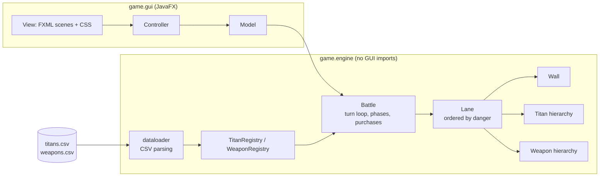

<div align="center">

# Attack on Titan: Lane Defense

**A turn-based, lane-based tower-defense game in Java with a JavaFX interface.**
Titans march down the lanes toward your walls. Spend resources on weapons and stop them before every lane falls.

[](https://github.com/Abdelrahmanshaheen1/aot_game/actions/workflows/engine.yml)


[](LICENSE)

</div>

## At a glance

| | |
|---|---|
| **Genre** | Turn-based lane defense. Score is the number of titans killed |
| **Modes** | Easy: 3 lanes, 250 resources per lane. Hard: 5 lanes, 125 per lane |
| **Design** | Engine with no GUI dependency (`game.engine`), JavaFX front end (`game.gui`), balance data in two CSV files |
| **Tested** | 13 headless engine checks run in CI on every push; the GUI is not covered |
| **Run it** | [Running it](#running-it) (needs a JavaFX SDK) |

> University OOP course project. Engine, data loading and GUI are all in this repo.

## Contents

[Gameplay](#gameplay) · [Titans and weapons](#titans-and-weapons) · [Architecture](#architecture) · [Project structure](#project-structure) · [Running it](#running-it) · [Tests](#tests) · [License](#license)

## Gameplay

- The battlefield is split into **lanes**, each protected by a **wall** (10,000 HP).
- Each turn, titans spawn and move toward the wall, weapons fire, and titans attack the wall when they reach it.
- You buy **weapons** with resources and place them on a lane of your choice.
- The battle moves through three phases, **Early, Intense, Grumbling**, which change which titans spawn.
- **Score** is the number of titans killed. The game is over when all lanes are destroyed.

| Mode | Lanes | Starting resources per lane |
|------|------:|----------------------------:|
| Easy | 3     | 250                         |
| Hard | 5     | 125                         |

### Titans and weapons

| Code | Titan |
|------|-------|
| 1 | Pure Titan |
| 2 | Abnormal Titan |
| 3 | Armored Titan |
| 4 | Colossal Titan |

| Code | Weapon class | In-game name | Price | Damage |
|------|--------------|--------------|------:|-------:|
| 1 | Piercing Cannon | Anti Titan Shell | 25 | 10 |
| 2 | Sniper Cannon | Long Range Spear | 25 | 35 |
| 3 | Volley Spread Cannon | Wall Spread Cannon | 100 | 5 (range 20-50) |
| 4 | Wall Trap | Proximity Trap | 75 | 100 |

All of these numbers live in `titans.csv` and `weapons.csv`, so the game can be rebalanced without touching the code.

## Architecture



Design points worth knowing:

- **Engine and GUI are separate**, which is why the engine can be tested without JavaFX.
- **Data-driven balance:** titan and weapon stats are loaded from CSV into registries, and a `WeaponFactory` builds weapons from the weapon codes.
- **Custom exceptions** (`InsufficientResources`, `InvalidLane`, `InvalidCSVFormat`) make the failure cases part of the API instead of silent returns.
- **Interfaces** (`Attacker`, `Attackee`, `Mobil`) describe what titans, weapons and walls can do, rather than a single deep class tree.

## Project structure

```text
src/game/
├── engine/          # game logic, no GUI dependencies
│   ├── Battle.java            # turn loop, phases, lane setup, weapon purchases
│   ├── base/                  # Wall
│   ├── lanes/                 # Lane (lanes are ordered by danger level)
│   ├── titans/                # Titan hierarchy + TitanRegistry
│   ├── weapons/               # Weapon hierarchy, WeaponRegistry, WeaponFactory
│   ├── interfaces/            # Attacker, Attackee, Mobil
│   ├── dataloader/            # CSV parsing
│   └── exceptions/            # InsufficientResources, InvalidLane, InvalidCSVFormat
└── gui/             # JavaFX front end (FXML scenes, CSS, images)
    ├── Main.java, Controller.java, Model.java, View.java
    └── resources/
ci/EngineSmokeTest.java        # headless engine checks
titans.csv, weapons.csv        # balance data
```

## Running it

Requirements: JDK 17+ and a [JavaFX SDK](https://gluonhq.com/products/javafx/) (built with 22.x) for your operating system.

The game reads `titans.csv` and `weapons.csv` from the current directory, so run it **from the repo root**:

```bash
export PATH_TO_FX=/path/to/javafx-sdk/lib

# compile
mkdir -p out
javac --module-path "$PATH_TO_FX" --add-modules javafx.controls,javafx.fxml \
      -d out $(find src -name "*.java" -not -path "src/game/tests/*")

# copy FXML / CSS / images next to the compiled classes
rsync -a --exclude='*.java' src/ out/

# run
java --module-path "$PATH_TO_FX" --add-modules javafx.controls,javafx.fxml \
     -cp out game.gui.Main
```

Or import the folder into Eclipse / IntelliJ, add JavaFX to the project, and run `game.gui.Main`.

## Tests

`ci/EngineSmokeTest.java` checks the game engine headlessly (no JavaFX needed): easy and hard mode setup, CSV loading, buying a weapon, the insufficient-resources and invalid-lane errors, the phase change at turn 15, and that an undefended battle ends. Run it from the repo root:

```bash
javac -d out $(find src/game/engine -name "*.java") ci/EngineSmokeTest.java
java -cp out EngineSmokeTest
```

GitHub Actions runs it on every push. Writing it exposed a bug that is now fixed: when the last lane was destroyed during a turn, `Battle.performTurn` tried to spawn titans into a lane that no longer existed and threw a `NullPointerException`. The GUI itself is not covered by the tests.

## License

The code is released under the [MIT License](LICENSE) © 2026 Abdelrahman Shaheen. *Attack on Titan* and its characters belong to their respective owners; this is a non-commercial course project, and the images in `src/game/gui/resources/images` are not covered by the MIT license.
